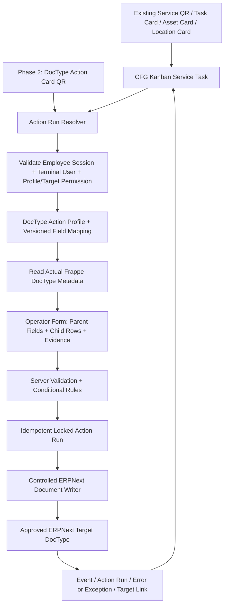

# CFG Kanban — Special DocType Card & DocType Action Engine

**Major Extension: Locked Functional and Technical Implementation Guideline**

| Item | Value |
|---|---|
| Document ID | `CFG-KANBAN-EXT-SDC-001` |
| Design status | **APPROVED DESIGN BASELINE / LOCKED FOR DEVELOPMENT PLANNING** |
| Document revision | `1.0` |
| Design lock date | **15 October 2026** |
| Application | **CFG Kanban**, ERPNext / Frappe v15 |
| Intended reader | Primary CFG Kanban development Work session; developer/implementer; functional tester |
| Implementation status | **NOT IMPLEMENTED BY THIS DOCUMENT** — all new records, fields, and behaviours are proposals until developed and tested |
| Current-code reference | User-provided `KANBAN_USER_MANUAL.md` (guide v1.0, dated 23 September 2026); canonical repository guide `docs/USER_MANUAL.md` |
| Suggested in-repository specification path | `docs/SPECIAL_DOCTYPE_CARD_EXTENSION.md` (create/maintain from the primary development session) |
| Execution policy | **ONE ongoing primary Kanban development Work session, ONE working tree/current active branch, sequential coding → testing → commit → push. No separate implementation worktree/branch or parallel editing session.** |

> **Handover instruction:** This document is the agreed target architecture, **not** a claim that the running ERPNext site already supports the feature. The implementing Work session must first inspect the current repository, installed DocType metadata, hooks, APIs, test layout, permissions, and deployment state. Preserve established CFG Kanban behaviour. If a proposed internal field name or class layout conflicts with existing code, keep the locked functional behaviour and document a justified schema adaptation in this file before coding it.

---

## 1. Purpose and the locked user concept

Turn a physical/digital Kanban identity into a simple, configurable operator interface that can **create, populate, save, and (where ERPNext permits) submit** a selected standard/custom ERPNext DocType. The operator sees **only necessary fields**, including **selected columns of first-level child tables**, and does not need to navigate the full ERPNext Desk form.

Example: an operator activates a service or special-purpose card, enters a short Case form, adds multiple action rows, optionally attaches private evidence, and posts the result. The destination **Case** is the authoritative ERPNext business document; CFG Kanban supplies the trigger, operator experience, execution controls, and audit trail.

**Design mandate:** One reusable, metadata-driven **DocType Action Engine** within the existing `cfg_kanban` application. Do not hard-code an individual integration for every Case/inspection/complaint DocType. Do not create a separate standalone Frappe app to implement this extension.

### 1.1 Immutable architectural decisions (locked)

| ID | Decision |
|---|---|
| D01 | Extend the existing CFG Kanban application, **not** a new app. |
| D02 | Build **one shared DocType Action Engine** and configure its behaviour through a profile. |
| D03 | Phase 1 invokes the engine from the existing **standalone Service Task** flow; Phase 2 exposes a reusable **DocType Action Card**. Both use the same engine. |
| D04 | The administrator selects a real ERPNext DocType; field selectors and child-table selectors come from **actual site DocType metadata**, never invented field names. |
| D05 | Render a simplified operator form with configured parent fields, defaults, dynamic conditions, and repeatable first-level child rows. |
| D06 | ERPNext remains system of record; saving, submission, validations, workflow, permission boundaries, and domain controls must be respected. |
| D07 | Preserve Employee-based operator QR/PIN sessions on a shared restricted ERP terminal, with separate Employee and terminal User attribution. |
| D08 | Use an explicit **allowlist** of approved target DocTypes/actions. This engine must not bypass existing Kanban manufacturing/stock command and gate controls. |
| D09 | Keep private media in the shared S3 media architecture; store durable media-registry references, **not** expiring S3 view URLs or copied binary blobs. |
| D10 | One source occurrence produces **at most one primary destination document in Phase 1**; retries never produce duplicates. |
| D11 | Configuration is previewable, server-validated, versioned, and auditable. |
| D12 | Implement/commit/push serially in the **one existing primary Kanban Work/repository workflow**. This specification does not authorize independent branches or conflicting parallel implementations. |

### 1.2 In scope versus out of scope

**In scope, Phase 1:** create draft, optionally submit if target supports it; automatically discover target parent/child fields; mapping from operator answers, current Service Task fields, server context and fixed values; conditional create; Service Task lifecycle integration; approval/verification gate; durable document link, events, errors/retry, profile preview and validation.

**Phase 2:** a new reusable **DocType Action Card** that can initiate/resume independent Action Runs without a Task Schedule, including its own QR scan entry in the appropriate operator panel.

**Deferred (not quietly assumed):** arbitrary bulk edits; updating pre-existing unrelated documents; amending/cancelling submitted target documents; arbitrary ERP workflow transitions; multi-document fan-out from one occurrence; nested child tables; spreadsheet-style formulas/scripts; unrestricted arbitrary Python/JavaScript expressions; automatic inventory/financial posting; offline posting queue; cross-app distributed transactions. These require separate scope, permissions, and acceptance tests.

---

## 2. Current CFG Kanban baseline — do not overwrite it

The **source snapshot** is the user-provided `KANBAN_USER_MANUAL.md`, guide v1.0, updated 23 September 2026. Its claims are code-verified **for the revision in which that guide shipped**, not necessarily for whatever revision is installed on implementation day.

### 2.1 Capabilities already described in that manual

- Existing exact **Card Type** choices: `Physical Unit Card`, `Physical Batch Card`, `Process Kanban`, `Station Kanban`, `Asset Card`, `Location Card`, `Task Card`.
- `CFG Kanban Task Schedule` defines standalone Service Task occurrences; `CFG Kanban Task` is the system-created occurrence. Manual/calendar scheduling and service-point resolution already exist.
- The independent Service Task interface is `/app/kanban-tasks`; production is `/app/kanban-operator`. Do **not** conflate standalone Service Tasks, production Process Tasks, or ERPNext manufacturing Job Cards.
- A permanent Service Point QR identifies a Schedule/location and resolves a current occurrence. The existing `Task Card`, `Asset Card`, and `Location Card` locate eligible Service Tasks rather than create Work Orders.
- `CFG Kanban Operator Profile` is Employee-based and controls operations; the terminal stays logged in as an ERPNext User with a restricted `Kanban Terminal` role. Employee identity, terminal User, timestamps, and action audit remain distinguishable.
- Existing dynamic field definitions cover `Operation`, `Process Task`, and `Standalone Task` with types such as Data, Int, Float, Check, Select, Date, Datetime, and Text.
- Standalone task checklist/evidence, supervisor verification/correction, and private S3 media upload are present in the source guide.
- `CFG ERP Command` is the existing auditable controlled-write mechanism for manufacturing-related ERP actions; do not use a new generic writer to undermine it.

### 2.2 Explicit gaps in the baseline

- **`DocType Action Card` is NOT one of the existing Card Types.**
- **`CFG Kanban DocType Action Profile`, Action Run and proposed mapping records do NOT yet exist** on the evidence supplied.
- Existing dynamic fields **do NOT automatically map into arbitrary target DocTypes**. The manual explicitly identifies arbitrary Job Card field mapping as not yet implemented; a generic DocType mapping engine is also not established.
- A Service Task does **not currently create/update/submit an arbitrary DocType** by itself. Existing service tasks are designed not to create Work Orders, Job Cards, or Stock Entries.

**Authority order during implementation:** deployed repository + running DocType metadata, then repository code guide for the matching revision, then this design guideline for proposed features. Do not present proposed fieldnames as currently available settings.

---

## 3. Required application architecture



### 3.1 Separation of responsibilities

| Component | Single responsibility |
|---|---|
| **Card / QR** | Stable identity that resolves a permitted activity. Not the business document. |
| **Standalone Service Task** | Scheduled/ad hoc work occurrence; checklists, readings, media, personnel and verification. May trigger one profile. |
| **DocType Action Profile** | Administrator-defined destination, field/table mapping, event, policy and authority. |
| **DocType Action Run** | One actual invocation; persisted form/posting progress, retries, linked target, errors and attribution. |
| **DocType Action Engine** | Auth, metadata validation, typed mapping, transactionally safe insert/save/submit, reconciliation. |
| **Target ERPNext DocType** | Authoritative Case/inspection/report/custom record with normal controller validations and workflow. |
| **CFG Kanban Media** | Private S3 registry, verification and authorized viewing; does not become a public target attachment. |

### 3.2 Reuse, not duplication

The new engine must **reuse** the existing operator session verification, operator profile/workstation boundaries, event/error conventions, maintenance evidence, and source-task status logic. Adapt a small, cohesive interface/API rather than maintaining a second login mechanism or parallel generic ERP transaction gateway.

Do not turn an independent Service Task into a production Process Task merely to trigger a target document. Do not introduce a Work Order or Job Card for service-related document capture.

---

## 4. Proposed configuration data model

**Everything in Section 4 is a PROPOSED schema**, to be confirmed against the real repo. The names are design suggestions, **not current app fields**. Use standard Frappe DocType structure and app-managed migration/fixtures.

### 4.1 Parent: `CFG Kanban DocType Action Profile` (administrator-created)

| Proposed screen label (`fieldname`) | Type | Purpose / rule |
|---|---|---|
| Profile Name (`profile_name`) | Data | Unique, descriptive configuration name. |
| Enabled (`enabled`) | Check | Only enabled validated profiles can run. |
| Description (`description`) | Small Text | Intended usage. |
| Company (`company`) | Link Company, optional | Restrict destination/sources to company context. |
| Target DocType (`target_doctype`) | Link DocType | Choose from **approved target allowlist** only. |
| Action Mode (`action_mode`) | Select | Phase 1: `Create New`; future: `Update Existing`. |
| Posting Policy (`posting_policy`) | Select | `Save Draft`, `Submit When Authorized`. Only allow Submit if target metadata supports it. |
| Verification Policy (`verification_policy`) | Select | `No Additional Verification`, `Require Service Task Verification` (Phase 1). |
| Posting Failure Policy (`failure_policy`) | Select | `Blocking` (recommended default) or controlled `Exception Logged` where explicitly permitted. |
| Form Title (`form_title`) | Data | Compact operator-facing heading. |
| Form Instructions (`form_instructions`) | Text | Operator guidance. |
| Conditional Trigger (`trigger_condition`) | Structured JSON / builder | Optional limited safe condition, e.g. `defect_found == true`; server evaluated. |
| Max Child Rows (`max_child_rows`) | Int | Configurable cap, bounded by system maximum. |
| Configuration Revision (`configuration_revision`) | Int | Monotonic revision on material mapping/policy change. |
| Validation Status (`validation_status`) | Select/read only | `Not Validated`, `Valid`, `Invalid`; calculated against target metadata. |
| Last Validated At (`last_validated_at`) | Datetime/read only | Last metadata/policy validation. |
| Target Metadata Fingerprint (`metadata_fingerprint`) | Data/read only | Used to detect changes requiring revalidation. |
| Parent Field Mappings (`parent_field_mappings`) | Table | Child DocType defined below. |
| Child Table Configurations (`child_table_configs`) | Table | One row for each mapped target table field. |
| Child Column Mappings (`child_column_mappings`) | Table | Flat rows grouped by parent table field; avoids nested Frappe child tables. |

**Allowed configuration owners:** authorized System Manager / `CFG Kanban System Maintenance` and deliberately granted supervisor administrators. No unrestricted operator edits to profiles. Activate only after `Validate Configuration` succeeds.

### 4.2 Child: `CFG Kanban DocType Field Map` (proposed)

Used under `parent_field_mappings`.

| Proposed field | Purpose |
|---|---|
| Target Field (`target_fieldname`) | Select from real non-Table fields in target DocType. |
| Source Type (`source_type`) | `Operator Input`, `Service Task Field`, `Server Context`, `Fixed Value`. |
| Source Key (`source_key`) | Existing Task field key or approved context selector, as applicable. |
| Fixed Value (`fixed_value`) | Typed static value; never a free-form Python expression. |
| Operator Label (`operator_label`) | Optional UI override; does not alter target metadata. |
| Show to Operator (`show_to_operator`) | Whether to render a field, subject to source and sensitivity rules. |
| Required in Kanban (`required_in_kanban`) | Additional requirement; may not weaken a target mandatory requirement. |
| Read Only (`read_only`) | Show calculated context without accepting client override. |
| Display Order (`display_order`) | Sort order. |
| Visible Condition (`visible_condition`) | Safe structured condition, no evaluated scripts. |
| Default Value (`default_value`) | Optional typed form default where allowed. |

A `Service Task Field` references a **real** key from the Schedule's `task_field_definitions` or another existing allowed Task evidence field. Avoid forcing operators to answer the same question twice. The engine should support a common dialog or prepopulation from existing Task evidence.

### 4.3 Child: `CFG Kanban DocType Child Table Config` (proposed)

| Proposed field | Purpose |
|---|---|
| Table Field (`table_fieldname`) | Actual Table fieldname in the parent DocType. |
| Child DocType (`child_doctype`) | Derived read-only from that Table field's `options`. |
| Operator Heading (`operator_heading`) | UI title for row group. |
| Rows Mode (`rows_mode`) | `Repeatable` or `Fixed Rows`. |
| Minimum Rows (`min_rows`) | Conditional minimum accepted rows. |
| Maximum Rows (`max_rows`) | Maximum operator rows for this table, within global safety cap. |
| Allow Add/Delete Rows (`allow_add_delete_rows`) | Controls row buttons. |
| Display Order (`display_order`) | Position relative to other table groups. |

### 4.4 Child: `CFG Kanban DocType Child Column Map` (proposed)

| Proposed field | Purpose |
|---|---|
| Table Field (`table_fieldname`) | Associates column with one parent Table configuration. |
| Child Field (`child_fieldname`) | Select actual non-Table field from corresponding child DocType. |
| Source Type (`source_type`) | Operator input, server context, fixed or allowed row template. |
| Source Key / Fixed Value | Approved source, appropriately typed. |
| Operator Label, Required, Read Only, Display Order | UI and validation properties. |
| Visible Condition (`visible_condition`) | Safe per-row conditional display/requirement. |

**Important Frappe design constraint:** Do **not** represent `Child Table Configurations` as a child table containing another child table of columns. Keep mappings flat on the parent profile; group the rows by `table_fieldname`. No nested child-row trees.

### 4.5 System-created: `CFG Kanban DocType Action Run` (proposed)

| Proposed field | Purpose |
|---|---|
| Source DocType / Source Name (`source_doctype`, `source_name`) | In Phase 1: `CFG Kanban Task` + specific occurrence; Phase 2: distinct card-initiated occurrence. |
| Action Profile / Revision (`action_profile`, `profile_revision`) | Immutable mapping/policy version chosen when run starts. |
| Action Slot (`action_slot`) | Stable key, Phase 1 `primary`; supports unique source/profile/slot identity. |
| Action ID / Retry Token (`action_id`, `retry_token`) | Opaque stable idempotency identities. |
| State (`state`) | Formal lifecycle in Section 7. |
| Operator Employee (`operator_employee`) | Employee who acted; not merely terminal User. |
| Terminal User (`terminal_user`) | Shared ERPNext session identity. |
| Posting Identity / Execution Policy (`posting_identity`, `execution_policy`) | Explicit audit of identity/context used for controlled writes. |
| Target DocType / Target Name (`target_doctype`, `target_name`) | Persistent link to target once created. |
| Target Docstatus (`target_docstatus`) | Last known ERPNext status; source target read is authoritative. |
| Source Event (`source_event`) | Activation / Start / Complete / Verify, etc. |
| Created At / Posted At / Last Retry At | Audit timestamps. |
| Error Code / Sanitized Error (`last_error_code`, `last_error`) | Operational diagnosis without sensitive secrets. |
| Mapping Snapshot / Hash (`mapping_snapshot`, `mapping_hash`) | Validated config snapshot or immutable canonical hash for consistency. |
| Submitted Evidence References | Registry IDs, not media files or expiring URLs. |

System-created runs must not be manually edited as ordinary business documents. Retain retries/changes in an immutable **Action Attempt or Event history** using the app's existing audit patterns. Introduce a separate audit child/DocType only if review of existing `CFG Kanban Event` and `CFG ERP Command` shows it is necessary; do not duplicate an existing reliable mechanism.

### 4.6 Proposed additions to existing records

- `CFG Kanban Task Schedule`: an optional **DocType Action Profile** (`doctype_action_profile`) Link to the new profile, plus **DocType Action Trigger** (`doctype_action_trigger`) with permitted choices such as `On Task Start`, `On Task Complete`, `After Supervisor Verification`. Add a **DocType Action Required** (`doctype_action_required`) Check to determine whether target posting gates task closure. These are **new proposed fields**, not currently available.
- `CFG Kanban Task`: link to the effective `CFG Kanban DocType Action Run` when generated; its run must pin the applicable profile revision/snapshot so schedule changes do not silently change already-open tasks.
- `CFG Kanban Card` (Phase 2 only): add the new **exact proposed Card Type** `DocType Action Card` and a required link to an Action Profile for that type; do **not** overload production `kanban_master` or assign replenishment quantities for special cards.

### 4.7 System policy and target allowlist

The administrator shall configure a site-specific approved set of **target DocType + allowed actions** with an explicit risk category. This could be a new settings child table or a protected dedicated policy DocType, whichever better fits the current repository. **Do not silently allow every installed DocType** merely because its metadata is readable.

Initial target policy: standard/custom operational DocTypes deliberately approved by the system maintainer. Default deny: finance/accounting, payments, stock movements, manufacturing/Work Orders/Job Cards, payroll, user/permission administration, server/configuration records, child-only DocTypes, and other security-critical or integrity-sensitive records. Any future exception needs a dedicated reviewed integration, not a global bypass switch.

---

## 5. Dynamic field discovery, mapping and UI rules

### 5.1 Discover actual site metadata

1. The administrator selects an allowlisted target DocType.
2. The server reads **effective** Frappe DocType metadata, including installed Custom Fields and applicable field properties.
3. The UI offers its eligible parent fields by **Label (`fieldname`)**, with field type and mandatory indicator.
4. For each selected parent `Table` field, obtain the actual child DocType from `options`; then offer its eligible child columns.
5. Never accept an unknown `fieldname`, changed child DocType, or arbitrary client-supplied key at runtime. Recheck metadata server-side on posting.
6. Revalidate or invalidate the profile on metadata fingerprint change, target removal, fieldtype change, invalid Link target, changed mandatory field, or changed allowed action. Open Action Runs continue only if their pinned mapping is still safe and compatible; otherwise go to supervised reconciliation.

### 5.2 Allowed field types — initial implementation

**First-pass operator controls:** Data, Small Text, Text, Long Text, Int, Float, Currency (if approved), Check, Select, Date, Datetime, and validated Link. Read-only/derived fields may display safely where appropriate. Use target precision, Link existence, Select options and current site validation rules.

**Do not enable by default:** Password, HTML, Code, Button, Fold, Section/Column Break, system-maintained status/identity fields, arbitrary Dynamic Link, Table MultiSelect, Attach fields requiring a normal Frappe File, and unknown/custom types. The target DocType's controller may reject an otherwise typed field; report that validation error without bypassing it. Expand supported types only with specific design/tests.

No generic ability for an operator to set `docstatus`, `owner`, `modified`, `modified_by`, `name`, system workflow state, permissions, or audit fields. A configured posting action, not a hidden input, controls Draft/Submit.

### 5.3 Value sources and defaults

The mapping engine must resolve one value from an **explicit** source and type-check it:

| Source | Examples | Security rule |
|---|---|---|
| Operator Input | Subject, priority, observations | Only mapped and authorized fields accepted. |
| Service Task Field | Measured value, `defect_found` condition | Must reference field from the effective Task definition; no arbitrary path traversal. |
| Server Context | Employee, Task name, approved company/location/asset/workstation, server timestamp | Derive again on the server, not from caller JSON. |
| Fixed Value | Default category / service source | Configured by authorized administrator; validated to target field type. |

A label is not a guaranteed destination fieldname. Illustrative values such as `reported_by` or `location` must only be selected if those actual fields exist on the chosen target DocType.

### 5.4 Mandatory and conditional behaviour

- A required destination field must be mapped to an input or valid server/fixed source, or configuration validation must fail. Target controller-mandatory conditions must still be evaluated at posting.
- A hidden conditional field must not secretly carry a stale incompatible value. Recalculate visibility/requirements on both client and server; discard/ignore disallowed client fields.
- Use a **restricted declarative condition builder**: field equals / not-equals / in-list, AND/OR, simple boolean/number comparison. No `eval`, `exec`, Python snippets, SQL fragments or unsafe JavaScript.
- Allow optional **conditional creation**, e.g. create a Case only if a configured Service Task answer `Defect Found = Yes`. If false, record `Skipped by Condition`; the Service Task may close normally, provided no other mandatory gate fails.
- Configure distinct error messages for no target permission, stale profile, missing destination requirement, failed target validation, unverified evidence, and network retry.

### 5.5 Child-table behaviour

- Show each configured target child table as a separate row group with a clear **Add Row / Remove Row** control if permitted.
- Support **multiple independently validated rows** on a single document (essential requirement).
- Respect row min/max, column types, target Link/Select constraints, and server-side validation of **every** row. Preserve row order (`idx`) deterministically.
- Repeating rows should be entered in one screen rather than forcing the operator to open each ERPNext child document.
- In Phase 1 support **one level** of Table → child-row fields. Do not promise grandchildren/nested table support.
- Limit request size, row count and field lengths; enforce these limits on the server as well as the UI.

### 5.6 Operator experience

- Phone/tablet-first touch layout consistent with `/app/kanban-tasks`; also usable on fixed shared scanners.
- Parent fields first, child-table groups next, task evidence/attachments when relevant, action bar last.
- Clear validation feedback beside each field/row; preserve in-progress data after recoverable errors.
- Show target DocType, form title, source Card/Task, current Employee and intended action **before posting**.
- Offer `Save Draft` and/or `Submit` **only when allowed** by policy/metadata/operator authority.
- Prevent duplicate clicks during posting; the server remains the final idempotency authority.
- On **Switch Operator / End Session / timeout**, close sensitive input, prevent a prior operator from continuing under a new identity, and do not leak draft data between users. A properly authorized user may resume an existing occurrence through server authorization.
- Include **Preview Operator Form** and **Validate Configuration** on the profile form. Preview uses realistic field/table layout but **does not create** a target document.

---

## 6. Scan/activation and event integration

### 6.1 Phase 1 — existing Service Task path (first delivery)

Keep the current schedule/occurrence model and card meanings:

```text
Task/Asset/Location Card OR permanent Service Point QR
  -> Resolve current CFG Kanban Task occurrence
  -> Authenticate and authorize Employee
  -> Start/complete/verify task using existing Service Task rules
  -> Evaluate optional DocType Action Profile at configured event
  -> Display / collect mapped form once
  -> Save Draft or Submit approved target document
  -> Retain target link + evidence link + Kanban action audit
  -> Continue or complete the Service Task according to gating policy
```

**Important:** Existing service QRs currently resolve the current task occurrence and respect recurrence/overlap. Never change that QR into an unconditional "create a new Case" trigger. Each generated Task occurrence is the identity boundary for one associated Action Run.

### 6.2 Event model

| Trigger | Phase 1 behaviour | Guardrail |
|---|---|---|
| `On Task Start` | Open/prefill form or create draft (if configured). | Start rights; do not submit prematurely. |
| `On Task Complete` | Collect final mapped values, write target draft or submit if policy permits. | Complete rights, mandatory data, evidence and target validations. |
| `After Supervisor Verification` | Finalize a pre-existing draft or create/post target after independent verification. | Verification must be by separately authorized verifier; cannot claim success before posting succeeds where posting is mandatory. |
| Conditional event not met | Record skipped outcome; no target created. | Clear audit and deterministic evaluation. |

**Gate requirement:** For a mandatory action, the Service Task must not be shown as fully satisfied/completed while its required target posting has failed or is unresolved. Implementation must inspect existing task transitions and ensure an atomic pre-finalization hook or an explicit **Pending Document Posting** state/gate without breaking established verification semantics. Where the action is explicitly non-blocking, a posting failure creates an Exception and retryable run, not a false success event.

A single Action Run may pass through draft creation at Start, field update at Complete, and submission after Verification — all pointing to **the same target document**, not three new Cases.

### 6.3 Phase 2 — direct `DocType Action Card`

- Add the new Card Type as a distinct **non-production** identity. It does not require a Kanban Master/BOM, does not create Signals/Cycles/Work Orders, and does not adopt production card quantity-state transitions.
- Link it to one active Action Profile. Allow an appropriate QR/card scan in the Service Task or dedicated DocType action interface without disturbing `/app/kanban-operator` manufacturing scan precedence.
- On scan, show authorized existing **in-progress Action Run(s)** and `Start New Action`. `Start New Action` creates a new opaque run identity, so one reusable card may create many different Cases over time.
- Re-scanning the same in-progress action/resubmitting its retry token must **resume** its run, not create a duplicate document. Distinguish explicit new intent from retry.
- Allow supervisors to view action history for the card and its linked target documents. The QR contains identity only; no credentials, direct write permission, or sensitive form payload.

---

## 7. Proposed Action Run lifecycle and idempotency

### 7.1 Lifecycle

```text
Configured / Ready
    |
    v
Form In Progress --> Ready to Post --> Posting --> Draft Created --> Submitted
    |                    |                |                |
    |                    +--> Failed <----+----------------+
    |                            |
    |                            +--> Retry / Reconcile --> existing target or safe repost
    |
    +--> Cancelled (only by controlled authorization)

Skipped by Condition (terminal no-document outcome)
Needs Reconciliation (unknown target outcome / external status divergence)
```

Actual state names may be adapted to current CFG conventions; **transitions and safety properties are locked**. A non-submittable target ends successfully at `Draft Created` / `Saved` (wording should match normal Frappe save semantics), never at a fictitious `Submitted`.

### 7.2 Uniqueness and race safety

- Phase 1 enforce a database-backed uniqueness boundary equivalent to **(source DocType, source occurrence Name, profile, `primary`)**. A stable event/retry token additionally deduplicates repeats of the same user action.
- Phase 2 uses a newly generated **explicit Action Run identity** when the operator chooses `Start New Action`; subsequent scans/retries refer to that existing run.
- Use server-side locking/transaction-safe uniqueness checks before inserts. A client-side disabled button alone is insufficient.
- Record target DocType and document Name as soon as the insert succeeds in the same database transaction. On retry, query the existing run/target and decide **update same draft**, **return existing result**, or **Needs Reconciliation**; never unconditionally insert again.
- Do not mark `Submitted` until the actual ERPNext submission/workflow succeeds. Read target docstatus as source of truth on reconciliation.
- An error after an uncertain response must not cause blind reposting. Reconcile target identity using persisted run linkage before further writes.
- Keep an immutable audit entry for attempt identity, Employee, terminal User, action, time, sanitized error and target result. Do not store private media URLs or secrets in error logs.

### 7.3 Retry and cancellation

- **Failed before insert:** same run can retry safely after input/configuration correction.
- **Draft created, submission failed:** retain and show the existing draft; retry its permitted submission, never create another draft.
- **Submitted target:** return existing success on duplicate request; do not amend/submit twice.
- **Unknown result:** place run in reconciliation; require supervised lookup/confirmation before issuing a potentially duplicating action.
- **Cancellation:** cancel the Kanban run only through controlled operator/supervisor authority and reason. Do not delete completed targets, remove submitted audit, or silently cancel externally used target documents. If a linked draft needs cancellation, use standard target DocType capabilities under explicit permission and audit.

---

## 8. ERPNext write contract and security model

### 8.1 Boundary contract

The engine may perform only the action described by the **active, validated, explicitly allowlisted** profile. The request body may contain values for mapped operator-input fields and child rows; it may **not** choose a different target DocType, add hidden fieldnames, alter company context, or supply its own privileged identity.

Server flow (conceptual, not copy-paste implementation code):

1. Resolve terminal ERP session and Kanban Employee session, verify expiry and device scope.
2. Resolve source Task/Card and ensure it is actionable for this Employee and event.
3. Load the pinned validated profile and current allowlist/action policy; verify company, workstation, operator scope and required independent verification.
4. Fetch current real target metadata and verify mapping compatibility and destination submission capability.
5. Resolve fixed/context/Service Task values server-side; accept only authorized operator values and validated child rows.
6. Evaluate conditional creation, field constraints, mandatory fields and size limits.
7. Lock/reuse the Action Run by stable idempotency identity; check for an existing target link.
8. Construct/update a standard Frappe document, letting normal DocType controller hooks/validations execute. Run submission only if target is submittable and authorization/workflow permit it.
9. Persist the target link, Action Run status and audit coherently. Avoid mid-operation commits that orphan the target from the run.
10. Return a concise success/error with target document link or actionable retry/reconciliation instructions.

### 8.2 Shared terminal and effective permissions

The source guide makes a firm distinction:

- **Employee:** Kanban operator identity from the scanned credential and `CFG Kanban Operator Profile`.
- **User:** restricted shared ERPNext terminal session; may differ from the Employee and **must not be treated as that Employee**.

**Implementer must choose a narrowly authorized posting mechanism**, based on actual Frappe permission APIs and the project's current command architecture. Two acceptable broad designs are (a) grant the restricted terminal only the necessary permitted target DocType rights **plus** mandatory server-side Employee/profile checks, or (b) a specifically designed server-side controlled integration executor with a tightly scoped approved action allowlist and explicit dual-identity audit. Neither method may depend on an unrestricted browser credential, arbitrary elevated RPC, generic `ignore_permissions` usage, or impersonating an Employee as an ERPNext User.

Action authorizations must cover **target DocType**, operation (create/submit), company scope, operator role/profile, workstation/asset scope where applicable, and approval/verification constraints. Validate on every write endpoint, not merely through hidden buttons.

### 8.3 Protect existing ERP domain controls

- Do not replace CFG Kanban's approved manufacturing `CFG ERP Command` path with generic form mapping for Work Orders, Job Cards, Stock Entries, or Batches.
- Never silently bypass stock/accounting/HR/ERPNext validation or controller hooks to make a profile post successfully.
- A target DocType without `is_submittable` must be saved, not force-set to `docstatus = 1`.
- If a target has a configured workflow, use only explicitly authorized transitions; the generic Phase 1 feature may refuse unsupported workflows instead of writing `workflow_state` directly.
- Prevent profile authors from mapping technical identity/status fields or writing into DocTypes outside the site allowlist.

### 8.4 Data privacy and abuse resistance

- Escape/operator-encode rendered text; treat every value as untrusted.
- Perform Link existence/permission checks and avoid showing unauthorized target choices in lookups.
- Prevent direct object reference attacks: an operator must not read another Employee's draft/action run just by knowing its Name.
- Keep audit/error logs minimal and redact tokens, sensitive values, URLs and credentials.
- Provide upload/field length/child row caps and request throttling as appropriate for shared terminals.
- Any profile configuration changes require a separate privileged permission from ordinary scan/post access.

---

## 9. Media/evidence integration

The uploaded guide already specifies private AWS S3 storage using `CFG Kanban Media`, server authorization and time-limited view URLs. This extension **must integrate with it**, not copy uploads into ordinary ERPNext files/database.

1. Continue normal Service Task evidence capture (including timestamped/GPS photo rules) and direct-to-S3 upload.
2. Accept only media objects verified `Available` and linked/authorized for the same task/run.
3. Persist stable `CFG Kanban Media` registry identities against the Action Run and present them from the target link/evidence viewer as permitted.
4. Never write an expiring presigned view URL to a permanent Case text/Attach field; never treat an unverified upload as completed evidence.
5. A different target DocType can link to evidence through a controlled Kanban relation/report without mutating every target schema. Adding an optional target custom field is a separate reviewed integration.
6. Preserve existing archive/remove retention and supervisor verification rules. Archiving a registry item does not silently delete S3 data or erase prior audit.

---

## 10. Example: Case creation from a Service Task

> **Illustrative only:** The supplied manual does not define a particular `Case` schema. Replace all example names below with actual fields discovered from the installed Case DocType. Do **not** install fields based solely on this example.

**Business scenario:** A housekeeping operator scans a location's permanent Service Point QR, begins the scheduled inspection, records a defect, adds a photograph, and completes the task. An authorized reviewer verifies the work. The configured action creates a corresponding Case containing only essential information plus child-table corrective actions.

### 10.1 Example profile intent

| Setting | Illustrative configuration |
|---|---|
| Profile Name | `Housekeeping Defect to Case` |
| Target DocType | `Case` — **only if installed and explicitly allowlisted** |
| Action Mode | `Create New` |
| Conditional Trigger | Task response `defect_found = true` |
| Posting Policy | `Save Draft`, or `Submit When Authorized` **only if Case is submittable** |
| Verification Policy | `Require Service Task Verification` if local procedure requires independent approval |
| Parent inputs | Subject, Priority, Description, Category — **only if those actual Case fields exist** |
| Server contexts | Current Employee, location, task reference, server timestamp — only to matching real target fields |
| Child table | Selected real Case Table field, e.g. corrective-action rows if present |
| Evidence | Reuse the Task's verified S3 media references |

### 10.2 Example operator experience

```text
Scan Housekeeping Service Point QR
  -> Current Task OCC-xxxx loaded
  -> Operator Employee confirmed
  -> Start Task
  -> Defect Found? [Yes]
  -> Show configured Case fields
       Subject: Leaking pipe below basin
       Priority: High
       Description: Water found on floor
       [Child table: Add Row]
         Row 1: Isolate water supply | Maintenance | ...
         Row 2: Replace damaged pipe  | Technician  | ...
  -> Attach existing Task evidence
  -> Complete task / request verification
  -> Authorized ERPNext save or submit
  -> Show Case ID/link and Kanban Action Run ID
  -> Record Event; retain same ID on repeated scan/retry
```

**Negative path:** `defect_found = false` -> task follows its existing completion path -> action is `Skipped by Condition`, no blank Case created.

**Validation path:** destination Case has another mandatory field not covered by mappings/defaults -> profile cannot be activated, or posting fails clearly if the destination schema changed since validation.

---

## 11. Operational screens and supervisor tools

### 11.1 Configuration screens

- Profile list and form: Active/Inactive, target DocType, approved action, mapping tables, trigger condition, verification policy, revision/validation result.
- **Select Fields** control reads metadata; show `Label (fieldname)`, type, mandatory/read-only flags.
- **Configure Child Table** selects parent Table field, then actual child DocType columns.
- **Preview Operator Form** shows layout for parent and child fields with conditional examples.
- **Validate Configuration** reports actionable errors and blocks enabling a broken profile.
- **Change History** records who revised the profile; active Action Runs remain pinned to their version.

### 11.2 Operator screens

- Show only currently permitted profile/action for source Task or Phase 2 special Card.
- Display action status: not started / in progress / saved draft / submitted / error needing attention.
- Resume without duplicate creation; maintain scanner-first usability and employee switch safeguards.
- Provide exact linked target DocType/Name on success and clear distinction between **Saved** and **Submitted**.

### 11.3 Supervisor/recovery screens

- View Action Runs by source, profile, destination, Employee, date and state.
- Filter `Failed`/`Needs Reconciliation`; show sanitized validation/retry failures and original linked target.
- Controlled `Retry Same Action`, `Reconcile Linked Document`, `Cancel Run with Reason` where allowed.
- Inspect private media evidence through existing authorized viewer.
- Show history of every retry and authority decision; **no direct status overwrite** and no deletion of successful audit.

---

## 12. Acceptance criteria — minimum functional tests

Tests MUST be implemented in the single primary development workflow. Each item is testable, not just an interface demonstration.

### A. Configuration and discovery

- [ ] Only allowlisted DocTypes are selectable; denied ERP records cannot be posted using the engine.
- [ ] A test custom DocType and its existing Custom Fields appear with exact fieldname/type.
- [ ] A parent Table field resolves the correct child DocType and displays only approved columns.
- [ ] Profile with missing unmapped mandatory destination field fails validation (unless a safe server source exists).
- [ ] Profile invalidates when target field/type/mandatory requirement changes; stale profiles cannot silently post.
- [ ] Preview renders fields/children without writing any destination document.

### B. Operator parent fields and child tables

- [ ] Operator sees **only configured fields**, correctly ordered and typed.
- [ ] Fixed context is server-controlled; client attempts to override Employee/Company/target DocType are rejected.
- [ ] Multiple child rows post into the correct child table in deterministic order.
- [ ] Empty/invalid row, missing mandatory column, invalid Link, invalid Select, max-row breach are rejected server-side.
- [ ] Conditional visibility/creation is evaluated identically server/client; no untrusted executable condition is accepted.
- [ ] Existing Service Task dynamic values can map without requiring duplicate operator entry.

### C. Service Task lifecycle

- [ ] Existing Task/Asset/Location Card and Service Point QR behaviour is unchanged without a profile.
- [ ] A configured Task creates exactly one Action Run and one target for one occurrence.
- [ ] Conditional `false` produces a recorded skip, not a blank document.
- [ ] Verified-after-approval route cannot submit before independent verification.
- [ ] Mandatory document-post failure does not falsely indicate a fully satisfied Task.
- [ ] Failed optional action creates visible Exception and retry path.
- [ ] Next service occurrence produces a new Action Run while older history remains intact.

### D. Posting integrity, security and retries

- [ ] A non-submittable DocType is **saved only**, never forcibly submitted.
- [ ] A submittable allowed target follows ERPNext controller, Docstatus and workflow checks.
- [ ] Source Employee, terminal User, posting identity, target link and time are recorded.
- [ ] Direct arbitrary REST/RPC calls cannot write an unallowlisted field/target even if UI controls are bypassed.
- [ ] Concurrent double-submit and repeated retry token return one target, not duplicates.
- [ ] Submission error after a saved draft resumes the same draft.
- [ ] Lost network response enters a safe reconciliation/retry path; never blind double insert.
- [ ] Employee switch, expired session, unauthorized workstation/company or missing permission blocks access/posting.
- [ ] Any attempt to target Work Order/Job Card/Stock Entry through this generic engine is denied by default.

### E. Evidence and operations

- [ ] Verified S3 media attaches as registry reference only; no presigned URL persisted in target.
- [ ] Unverified/unauthorized media is rejected; archived evidence respects existing viewing rules.
- [ ] Failed and reconciled runs appear in supervisor audit, with full attempt history and no secret leakage.
- [ ] New DocTypes and fields deploy from app-managed migration/fixtures and survive migrate/build/cache clear.
- [ ] Legacy production, QC, operator scanning, Work Order/Job Card/stock, maintenance schedules and Service Task panels pass regression tests.

### F. Phase 2 card-specific tests

- [ ] New `DocType Action Card` is non-production and does not create Signals/Cycles/Work Orders.
- [ ] Reuse of same physical card via explicit `Start New Action` creates a **new** run/document.
- [ ] Re-scan while a run is open resumes the same run; repeated submit never duplicates.
- [ ] QR replacement/revocation, operator authority, target allowlist and history work as expected.

---

## 13. Development sequence and delivery gates

### Gate 0 — baseline audit (mandatory before coding)

In the **existing main Kanban development Work session**:

1. Inspect current repo/branch/uncommitted changes, current app version, deployed site and installed DocTypes. Do not assume this 23 September manual equals today's deployed code.
2. Locate current Task Schedule, Task occurrence, Card DocType, operator session API, Service Task JS/page, existing dynamic fields, QR resolver, private S3 media and audit/ERP Command routines.
3. Compare live metadata against this proposed schema; resolve actual class/doctype names before generating migrations. Preserve source-compatible behaviour.
4. Record implementation checklist and test baseline in the same Work session; no competing secondary code workspace.

### Gate 1 — reusable core + Phase 1 Service Task integration

Implement in this order to keep commits testable:

1. Protected target allowlist / policy and profile permissions.
2. Profile + flat parent/child mappings + validation/versioning/preview.
3. Idempotent system-created Action Run and audit/error integration.
4. Safe server mapper/writer using real metadata, permission checks and existing ERP APIs.
5. Service Task event binding, conditional trigger and required-posting completion gate.
6. Unified operator UI, dynamic child-table rows, target success/error and retry.
7. Media references and supervisor recovery screens.
8. Automated tests plus one **non-submittable** custom DocType and one **submittable** test DocType pilot.

**Gate 1 completion:** all acceptance criteria A–E pass and one live test Service Task produces a valid linked Case (or approved pilot target) with parent and child rows.

### Gate 2 — Phase 2 direct special Card

1. Introduce exact new Card Type `DocType Action Card` and new profile link, migrations and validation.
2. Add non-production QR scan resolver and `Start New Action` / `Resume` UX.
3. Reuse Gate 1 engine, Action Run policy, permissions, evidence and audit without forks.
4. Execute acceptance criteria F and confirm no regression to the seven existing card types.

**Gate 2 completion:** one reusable physical QR can deliberately open many separate Cases, while retries/resumes never duplicate a Case.

### Gate 3 — future design review only

Potential controlled update to existing targets, workflow transition adapters, multi-document orchestration, app-to-app invocation and more complex types. Do not implement under this design lock without a separate approved revision.

---

## 14. Mandatory single-Work implementation / Git continuity policy

**User's explicit instruction:** *Coding, committing, and pushing will be performed in one ongoing Kanban development Work session/file for continuity, rather than branching the development effort.* The spec is a handover artifact, **not a separate coding task**.

**Rules for the implementer:**

1. Continue development in the **existing primary CFG Kanban Work conversation and its current repository working tree**. Treat this Markdown specification as an input to that Work session; do not start a second agent doing code edits independently.
2. Do **not** create a new development branch/worktree or make parallel modifications in another coding session solely for this extension. Stay on the already active, intended branch (confirm its name first; do not assume `main`).
3. Before touching code, inspect `git status`, active branch, remote, uncommitted changes and current site. Preserve/resolve existing work safely; do not reset, overwrite or force-push others' changes.
4. Work through the gated sequence and make **small, reviewable sequential commits** in that same branch, with migrations/tests/documentation accompanying behaviour changes. Use the repo's established test and deployment standards.
5. After each stable gate: run tests, review diff, update this guideline's implementation status, update canonical `docs/USER_MANUAL.md` with **exact live screen labels/internal fieldnames**, commit, and push through the primary Work session's normal verified remote workflow. Do not promise implementation or push until checks succeed.
6. Take a development-site backup before migrations; migrate/build/clear cache/restart as appropriate to the site only under the established deployment procedure. Do not touch production before pilot acceptance.
7. Keep the **design lock** stable; if a genuinely necessary change arises, record `Change ID`, reason, impact, decision and date **in this file** and obtain the product owner's approval before broadening business scope.
8. Never manually edit generated transactional Action Runs or post through a side script to bypass broken workflow. Fix the engine or use controlled recovery.

### Suggested sequential commit themes (examples, not exact commands)

```text
feat(kanban): add approved doctype action profile and metadata validation
feat(kanban): add idempotent doctype action run and controlled writer
feat(kanban): integrate doctype actions with service task events
feat(kanban): add parent and child-table operator forms
test(kanban): cover permissions, retries, posting and S3 evidence
docs(kanban): update exact UI manual and locked extension status
feat(kanban): add non-production doctype action card scan flow
```

**Not authorized now:** code edits, installation, migration, committing, pushing, new branch/worktree or independent deployment. This deliverable locks the guideline only.

---

## 15. Definition of done and handover checklist

The extension is **functionally complete** only when:

- [ ] It is configured from real DocType metadata rather than per-target custom scripting.
- [ ] A normal operator can open a minimal parent form plus repeatable child rows and create a valid target document.
- [ ] Saving and submitting are truthfully distinguished and controlled by the target's ERPNext rules.
- [ ] A Service Task can trigger the action at approved events, including optional supervisor verification and conditional creation.
- [ ] The reusable direct Card flow is delivered in Phase 2 using the **same** engine.
- [ ] Employee identity/terminal User, profile revision, target link, immutable attempts, errors, media and recovery are auditable.
- [ ] Duplication, malicious mapping, permission bypass, false completion and S3 URL leakage are covered by tests.
- [ ] Current Kanban production/maintenance behaviour survives full regression testing.
- [ ] Canonical user manual and migration notes reflect the actual deployed version and exact fields.
- [ ] All coding, tests, commits and pushes happened serially through the **single main Kanban Work session**, not a competing implementation branch.

### Ready-to-paste instruction for the main CFG Kanban development Work session

> Adopt `CFG_KANBAN_SPECIAL_DOCTYPE_CARD_EXTENSION_LOCKED.md` (revision 1.0, 15 October 2026) as the locked product/engineering target for the Special DocType Card extension. First audit the current repository, deployed metadata, existing Service Task and operator systems, and reconcile the source manual. Implement Gate 1 then Gate 2 in this **same existing Kanban Work session and current working tree/branch**; do not create parallel branches, worktrees or side sessions. Preserve all existing seven card types and manufacturing controls. Use actual Frappe DocType metadata, one reusable engine, allowlisted writes, dynamic parent/child fields, Employee-based authorization, S3 registry references, immutable Action Runs and idempotent retries. Add tests, migrations, UI validation and supervisor recovery. Commit and push only after each gate's tests; update `docs/USER_MANUAL.md` and this specification with implemented exact names/status. No code is authorized merely by receiving this document; begin implementation only upon the owner's explicit instruction.

---

## 16. Decision/change register

| Date | Revision | Decision / change | Owner approval |
|---|---|---|---|
| 2026-10-15 | 1.0 | Locked high-level architecture, parent/child dynamic mapping, Service Task-first integration, direct Card Phase 2, security/idempotency/S3 controls, and single-Work coding policy. No code changes performed. | User requested design lock and handover guideline |

**End of locked guideline.**

---

## Implementation status (maintained with the repository)

This status section records delivery without changing the locked revision 1.0 decisions above.

| Date | Package | Implemented exact records / behaviour | Status |
|---|---|---|---|
| 2026-10-16 | Gate 1A — configuration foundation | `CFG Kanban DocType Action Policy`, `CFG Kanban DocType Action Profile`, `CFG Kanban DocType Field Map`, `CFG Kanban DocType Child Table Config`, `CFG Kanban DocType Child Column Map`; protected target allowlist; hard-denied ERP core records; effective-metadata discovery/fingerprint; server validation; non-posting operator preview | Prepared in code; migration and live-site validation pending |
| 2026-10-16 | Gate 1B — non-posting Action Run foundation | System-created `CFG Kanban DocType Action Run` and immutable `CFG Kanban DocType Action Attempt`; unique source/profile/primary-slot and retry identities; pinned validated profile snapshot/hash; Employee/session/terminal attribution; formal locked states; row lock and guarded transitions; source Task/Event links; sanitized failures; Supervisor-only cancellation/reconciliation controls | Prepared in code; migration and live-site validation pending |
| 2026-10-16 | Gate 1C — controlled mapper/writer foundation | Server-authorized Action Run form contract; immutable-snapshot target and field selection; typed parent/first-level child mappings; Service Task, server, fixed and allowlisted operator values; safe trigger/visibility conditions; target metadata and terminal-User permission enforcement; normal target insert/save/submit controllers; one-target retry reuse; persisted validated payload hash; explicit Draft/Submitted/Skipped/Failed/Reconciliation outcomes | Prepared in code; migration, Service Task UI binding and live-site validation pending |
| 2026-10-16 | Gate 1D — Service Task event binding and closure gate | Optional `doctype_action_profile`, exact Start/Complete/After Verification trigger and required-action setting on Task Schedule; immutable occurrence snapshot on `CFG Kanban Task`; automatic idempotent Run resolution; explicit `Pending Document Posting`; Draft/Submit/Skipped-aware release; premature submission/verification combination checks; Event linkage; controlled linked-Run disposition | Prepared in code; migration, Gate 1E operator form and live-site validation pending |
| 2026-10-16 | Gate 1E — Service Task operator document form | Exact-event automatic form opening in `Kanban Service Tasks`; fixed Action destination/posting summary; approved parent controls; read-only context; safe reactive JSON visibility; mobile repeatable first-level child rows; configured row limits; explicit Save Draft versus Submit labels; idempotent retry-token retention; in-dialog controlled failure; required-pending resume; terminal/target feedback; initiating-verifier exact-Run resume | Prepared in code; migration and live-site pilot validation pending |

**Current boundary after Gate 1E:** Service Task occurrences resolve their one Action Run, open the
mapped parent/child form on phone/tablet, post through the controlled writer and cannot falsely close
while a required result is unresolved. Action-specific media linking, supervisor recovery screens,
non-submittable/submittable live pilot fixtures and the Phase 2 direct `DocType Action Card` remain
subsequent serial packages.

